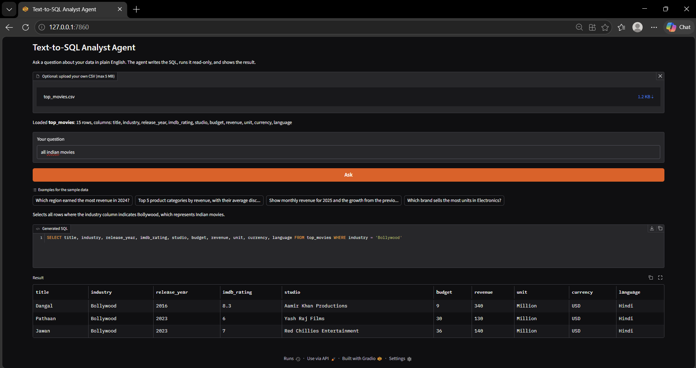

# Text-to-SQL Analyst Agent

Ask questions about your data in plain English. This app uses an LLM to generate DuckDB SQL, validates the query, executes it in read-only mode, and displays the results in a Gradio interface.

## Demo

### 1. Upload a CSV and ask a question

Upload a CSV file (up to 5 MB), enter a question in plain English, and select **Ask**. The app detects the uploaded file's table name and columns.



### 2. Review the generated SQL and results

The app displays an explanation, the generated SQL query, and the result table. In this example, the question asks for Indian movies and the generated query filters the `industry` column to `Bollywood`.


## Features

- **Natural-language querying:** Ask questions about a dataset without writing SQL yourself.
- **LLM-generated SQL:** Uses an NVIDIA NIM-compatible API through the OpenAI Python client.
- **Read-only query execution:** Connects to the DuckDB database in read-only mode and disables external access for query execution.
- **SQL validation:** Allows one `SELECT` or `WITH` query and blocks multiple statements and selected dangerous operations.
- **Self-correction:** Sends query or parsing errors back to the model for up to three attempts.
- **CSV upload:** Upload a CSV up to 5 MB; the app creates a temporary DuckDB database for that upload.
- **Result preview:** Shows generated SQL and returned rows in the Gradio interface.

## Tech stack

- Python
- Gradio
- DuckDB
- NVIDIA NIM API (OpenAI-compatible client)
- Pydantic
- pandas
- python-dotenv

## Project structure

```text
text-to-sql-agent/
├── agent.py              # Prompting, SQL validation, and query execution
├── app.py                # Gradio user interface
├── generate_data.py      # Creates the sample e-commerce database
├── ecommerce.duckdb      # Generated sample database (created locally)
├── requirements.txt      # Python dependencies
├── .env                  # Local API key; do not commit
├── .gitignore
├── README.md
└── assets/
    ├── text-to-sql-agent-demo-1.png
    └── text-to-sql-agent-demo-2.png
```

## Getting started

### 1. Clone the repository

```bash
git clone https://github.com/sagarfadatare/Text-to-Sql-Agent.git
cd Text-to-Sql-Agent
```

### 2. Create and activate a virtual environment (recommended)

Windows PowerShell:

```powershell
python -m venv venv
.\venv\Scripts\Activate.ps1
```

macOS/Linux:

```bash
python -m venv .venv
source .venv/bin/activate
```

### 3. Install dependencies

```bash
python -m pip install -r requirements.txt
```

### 4. Configure the API key

Create a `.env` file in the project root and add your NVIDIA API key:

```dotenv
NVIDIA_API_KEY=your_nvidia_api_key_here
```

The code defaults to the NVIDIA NIM API base URL and model configured in `agent.py`. You can optionally set `NVIDIA_BASE_URL`, `NVIDIA_MODEL`, or `DB_PATH` in `.env` to override those defaults.

**Security:** Never commit `.env` or publish your API key. Keep `.env` in `.gitignore`.

### 5. Create the sample database

```bash
python generate_data.py
```

This script generates a local DuckDB sample e-commerce dataset with 20,000 orders and customer/product dimension tables.

### 6. Start the app

```bash
python app.py
```

Open the local URL printed by Gradio in your browser.

## Example questions

For the sample e-commerce dataset:

- Which region earned the most revenue in 2024?
- What are the top five product categories by revenue?
- Show monthly revenue and month-over-month growth.
- Which brand sells the most units in Electronics?

For an uploaded CSV, try questions that refer to the actual columns in your file. For example, the screenshots use a `top_movies.csv` dataset:

- Show all Indian movies.
- Which movie has the highest IMDb rating?
- List movies released after 2020.

## Safety notes and limitations

- The SQL runner is designed for read-only queries and applies a row limit to results.
- SQL keyword checks are a defensive filter, not a complete security boundary. Review the implementation before exposing the app to untrusted users or deploying it publicly.
- CSV uploads are limited to 5 MB and are loaded into a temporary database for that app session.
- An NVIDIA API key and API access are required for LLM-generated answers.
- The sample e-commerce database is generated locally by `generate_data.py`; it is not required to be committed to GitHub.

## Roadmap

- [x] CSV upload
- [x] SQL generation and result display
- [x] Read-only DuckDB query execution
- [ ] Add charts for suitable query results
- [ ] Add automated tests with known expected answers
- [ ] Explore deployment on Hugging Face Spaces

## Author

**Sagar Fadatare**

GitHub: [@sagarfadatare](https://github.com/sagarfadatare)

---

If you find this project useful, consider giving the repository a ⭐.
